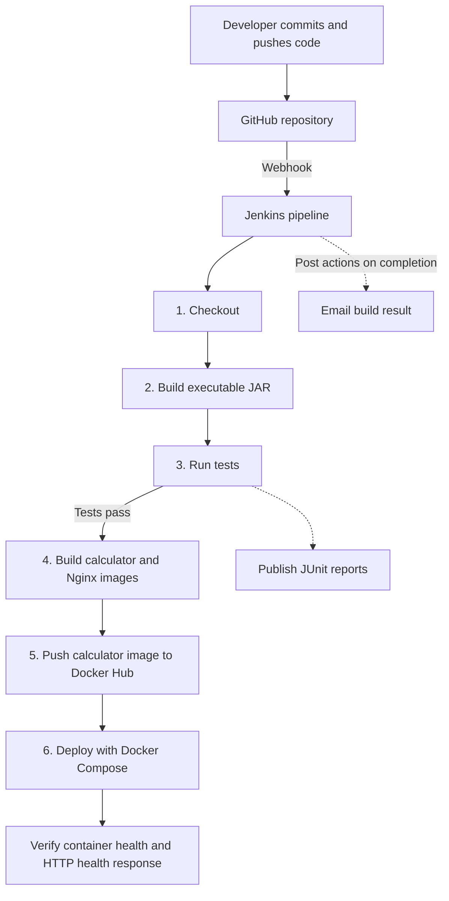
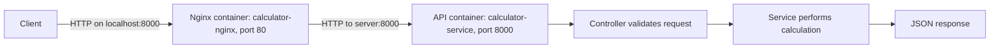
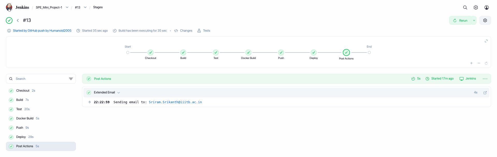
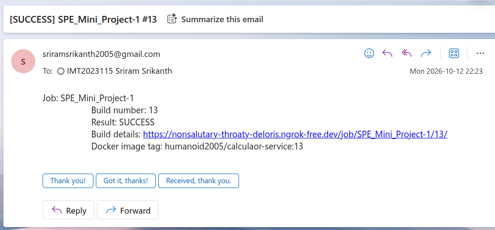
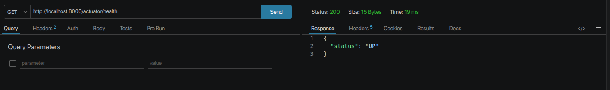

# Calculator REST API with CI/CD

This Software Production Engineering mini-project implements a calculator REST API with Java and Spring Boot. Its main purpose is to demonstrate an automated workflow: a GitHub push triggers Jenkins, which builds and tests the application, creates Docker images, pushes the calculator image to Docker Hub, and deploys the application with Nginx using Docker Compose.

## Technology stack

| Component | Purpose |
| --- | --- |
| Java 21 and Spring Boot 3.3.4 | Implement the REST API and application health endpoint. |
| Maven | Resolve dependencies, compile code, run tests, and package an executable JAR. |
| JUnit 5, Mockito, and MockMvc | Test arithmetic logic, HTTP endpoints, validation, and application integration. |
| Git and GitHub | Maintain commit history, feature branches, and pull requests; trigger Jenkins through a webhook. |
| Jenkins | Execute the six CI/CD stages and send build-result emails. |
| Docker | Package the calculator and Nginx as separate images. |
| Docker Compose | Manage the two containers, their network, restart policies, and health checks. |
| Nginx | Receive requests on host port 8000 and forward them to the calculator. |

## Pipeline architecture



GitHub's webhook and Jenkins email settings are configured outside the repository. The pipeline definition is stored in `Jenkinsfile`. A local Jenkins installation can receive GitHub webhooks through a publicly reachable tunnel, such as ngrok; the tunnel must be running separately.

### Description of each stage

| Stage | What it does |
| --- | --- |
| **Checkout** | Uses `checkout scm` to obtain the configured GitHub revision. It leaves the existing deployment running. |
| **Build** | Runs `mvn -B clean package -DskipTests` to compile the application and create `target/calculator.jar`. Tests are skipped in this stage. |
| **Test** | Runs `mvn -B test`. Jenkins publishes `target/surefire-reports/TEST-*.xml` even when tests fail. A test failure stops subsequent stages. |
| **Docker Build** | Builds the calculator image from `Dockerfile` and the Nginx image from `Dockerfile.nginx`. Both receive the Jenkins build number as their tag. |
| **Push** | Retrieves the Docker Hub username and token from Jenkins Credentials, logs in using `--password-stdin`, and pushes the calculator image. The Nginx image remains on the deployment Docker daemon. |
| **Deploy** | Runs `docker compose up -d --no-build --pull never --remove-orphans --wait --wait-timeout 180`, checks `/actuator/health` for `UP`, and displays the running services. |

After the pipeline finishes, `emailext` sends the result, job name, build number, build URL, and calculator image tag to the configured recipient. Concurrent executions of this Jenkins job are disabled, and the pipeline has a 30-minute timeout.

For build number `15`, the image tags are:

```text
humanoid2005/calculaor-service:15
calculator-nginx:15
```

Build, test, image-build, and push failures leave the current containers running. Compose replaces changed containers during deployment and retains old images. A failed deployment is reported by the health checks; automatic rollback is not implemented.

## Deployment architecture



Both containers join the Compose `calculator` bridge network. `server` is the calculator's Compose service name and is used by Nginx to reach the API. Only Nginx publishes a host port. It starts after the calculator passes its health check, and its own health check verifies the proxied health endpoint. Both services use `restart: unless-stopped`.

The calculator Dockerfile has two stages:

1. **Maven/JDK build stage:** copies `pom.xml`, downloads dependencies into a cached layer, copies the source, and packages the JAR.
2. **JRE runtime stage:** copies only the built JAR from the build stage, includes `curl` for health checks, and runs Java as the non-root `calculator` user. Maven and the source code are not copied into the final image.

The Nginx Dockerfile copies `nginx.conf` into the image. No Jenkins workspace file needs to be mounted at runtime.

## Code structure

```text
SPE_MiniProject/
├── src/
│   ├── main/
│   │   ├── java/com/example/demo/
│   │   │   ├── Application.java
│   │   │   ├── controller/
│   │   │   │   ├── AdditionController.java
│   │   │   │   ├── SubtractionController.java
│   │   │   │   ├── MultiplicationController.java
│   │   │   │   └── DivisionController.java
│   │   │   ├── models/
│   │   │   │   └── CalculationResponse.java
│   │   │   └── service/
│   │   │       ├── AdditionService.java
│   │   │       ├── SubtractionService.java
│   │   │       ├── MultiplicationService.java
│   │   │       ├── DivisionService.java
│   │   │       └── ApiExceptionHandler.java
│   │   └── resources/application.properties
│   └── test/java/com/example/demo/
│       ├── ApplicationTests.java
│       ├── CalculatorIntegrationTest.java
│       ├── controller/                # HTTP endpoint and Actuator tests
│       └── service/                   # Arithmetic unit tests
├── assets/                            # Screenshots from pipeline and API runs
├── pom.xml
├── Jenkinsfile
├── Dockerfile
├── Dockerfile.nginx
├── nginx.conf
├── docker-compose.yml
├── .dockerignore
├── .gitignore
└── README.md
```

### Codebase components

| File or component | Responsibility |
| --- | --- |
| `Application.java` | Starts Spring Boot and enables component discovery. |
| Arithmetic controllers | Map the four GET endpoints, accept numeric parameters, validate inputs, call the appropriate service, and return a `CalculationResponse`. |
| Arithmetic services | Perform addition, subtraction, multiplication, and division. `DivisionService` returns `null` for a zero denominator; `DivisionController` converts this into a validation error. |
| `CalculationResponse.java` | Defines the JSON fields `operation`, `a`, `b`, and `result`. Rejects non-finite inputs and results outside the supported numeric range. |
| `ApiExceptionHandler.java` | Uses `@RestControllerAdvice` to return structured HTTP 400 errors for missing parameters, invalid numeric parameters, and invalid calculations. |
| `application.properties` | Sets the application name and port, exposes Actuator health, and hides health details. It also records an ngrok domain; this property does not start a tunnel or configure a webhook. |
| `pom.xml` | Defines dependencies, Java 21, Maven build plugins, and the output name `calculator.jar`. |
| `Jenkinsfile` | Defines the six stages, credential binding, image tags, deployment verification, and email notification. |
| `Dockerfile` and `Dockerfile.nginx` | Build the calculator runtime image and the Nginx image containing its configuration. |
| `nginx.conf` | Listens on port 80 and forwards requests to `http://server:8000`. |
| `docker-compose.yml` | Defines images, builds, container names, networking, environment variables, port mapping, health checks, and restart policies. |
| `.dockerignore` and `.gitignore` | Exclude local tooling, credentials, and unnecessary generated files from the Docker build context and Git history. |

## Build, test, and run

### Prerequisites

- Java 21 and Maven to build or run the application directly.
- Docker and Docker Compose to run the container stack.
- Available host port 8000, or an alternative supplied through `PORT`.

Clone the repository:

```bash
git clone https://github.com/Humanoid2005/SPE_MiniProject.git
cd SPE_MiniProject
```

### Run the application directly

```bash
mvn clean package
java -jar target/calculator.jar
```

`mvn clean package` runs the tests before packaging. To run only the tests:

```bash
mvn test
```

The test suite covers arithmetic operations, division by zero, controller responses, missing and invalid inputs, non-finite numbers, numeric overflow, application startup, and Actuator health. `CalculatorIntegrationTest` uses the real application services with MockMvc. JUnit XML reports are generated in `target/surefire-reports/`.

### Run the complete stack

Choose this mode or the application-only mode above; both use host port 8000 by default.

```bash
docker compose up -d --build --pull never --wait --wait-timeout 180
docker compose ps
```

Docker builds the JAR inside the calculator image, so a separate local Maven build is not required for this command. Local image names default to `calculaor-service:local` and `calculator-nginx:local`.

To use another host port:

```bash
PORT=8001 docker compose up -d --build --pull never --wait --wait-timeout 180
```

Useful commands:

```bash
docker compose logs --tail=100 server nginx
docker compose down
```

`docker compose down` stops and removes this stack's containers and network. It does not remove the images by default.

## API endpoints

All calculator endpoints accept the required query parameters `a` and `b`.

| Method | Endpoint | Operation |
| --- | --- | --- |
| GET | `/api/v1/add?a=2&b=3` | Addition |
| GET | `/api/v1/subtract?a=6&b=2` | Subtraction |
| GET | `/api/v1/multiply?a=6&b=2` | Multiplication |
| GET | `/api/v1/divide?a=6&b=2` | Division |
| GET | `/actuator/health` | Application health |

Actuator returns `{"status":"UP"}` when the configured health checks pass. This response comes from Spring Boot Actuator, not a hardcoded controller. The `/actuator` endpoint lists links to exposed management endpoints. API documentation is also available at `http://localhost:8000/swagger-ui/index.html`.

## Jenkins configuration

The Jenkins agent needs Java 21, Maven, Git, Docker, Docker Compose, `curl`, and access to the deployment Docker daemon. Required Jenkins capabilities include Pipeline, Git integration, Credentials Binding, JUnit report publishing, and Email Extension.

1. Configure the pipeline job to load `Jenkinsfile` from the repository's deployment branch.
2. Enable the GitHub webhook trigger in the job and configure the repository webhook to reach Jenkins' `/github-webhook/` endpoint. If using a tunnel, use its public URL.
3. Store the Docker Hub username and access token as a **Username with password** credential. The Push stage references its credential ID through `withCredentials`.
4. Configure **Extended E-mail Notification** in Jenkins system settings with Gmail SMTP, port 465, SSL, and the saved Gmail username/app-password credential. The current `emailext` call uses these global SMTP settings.
5. Ensure the agent can reach the Docker daemon. This installation sets `DOCKER_HOST` to `unix:///home/sriram-srikanth/.docker/desktop/docker.sock`; update it when using a different machine or Docker installation.

Jenkins builds and deploys on the same Docker daemon. Only the calculator image is pushed to Docker Hub; the locally built Nginx image must remain available for deployment. Tokens and app passwords stay in Jenkins Credentials and are not hardcoded in the repository.

## Challenges faced

### Docker connection denied from Jenkins

The Docker Build stage initially failed with `permission denied` when connecting to the Docker Desktop socket. Docker commands worked under the desktop user, but Jenkins ran under the separate `jenkins` account. That account needed directory traversal permission and read/write access to the socket.

The fix was to grant access specifically to Jenkins. With home-directory traversal already permitted, socket access was added using:

```bash
setfacl -m u:jenkins:rw /home/sriram-srikanth/.docker/desktop/docker.sock
```

This lets Jenkins control the Docker daemon. If Docker Desktop recreates the socket, its ACL may need to be applied again.

### Repeated Maven builds and pipeline delay

Jenkins' Build stage packages the JAR, and the Maven/JDK stage in the Dockerfile packages it again. This repeats compilation and packaging and increases pipeline time, especially on the first run when images and dependencies must be downloaded.

Both builds were retained to satisfy the separate Jenkins Build stage and the required Maven/JDK-to-JRE multi-stage Dockerfile. Copying `pom.xml` and running `mvn dependency:go-offline` before copying `src` allows source-only changes to reuse the dependency layer. Docker can reuse all build layers when their inputs are unchanged. Caching reduces repeated work but does not eliminate recompilation when the source changes.

### Nginx configuration mount failed in Jenkins

The calculator became healthy, but Nginx failed with a file/directory mount error for `nginx.conf` in the Jenkins workspace. The file existed on the host, but the runtime bind mount through Docker Desktop failed.

`Dockerfile.nginx` now copies the configuration into the image at build time. Removing the bind mount avoids depending on the Jenkins workspace path during container startup.

### Keeping the existing deployment during CI

The original Checkout cleanup removed running containers before building or testing. A later failure could therefore leave the API unavailable. Cleanup was removed from Checkout, allowing the existing deployment to keep serving requests until Deploy. Both images receive build-number tags so Compose updates the API and proxy together, and the proxy resolves the replacement API container's address when it starts.

## Screenshots

The `assets/` directory contains evidence from pipeline and API runs. These screenshots show earlier runs and do not necessarily represent the latest commit.

### Successful pipeline



### Success email



### Actuator health



Additional screenshots: [failed pipeline](assets/build_failure_jenkins.png), [failure email](assets/build_failure_mail.png), [Git history](assets/github-history.png), [addition](assets/add.png), [subtraction](assets/subtract.png), [multiplication](assets/multiply.png), [division](assets/divide.png), and [division-by-zero error](assets/divide_error.png).
